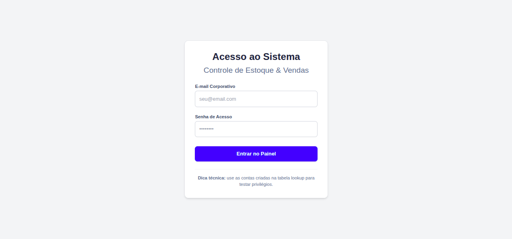
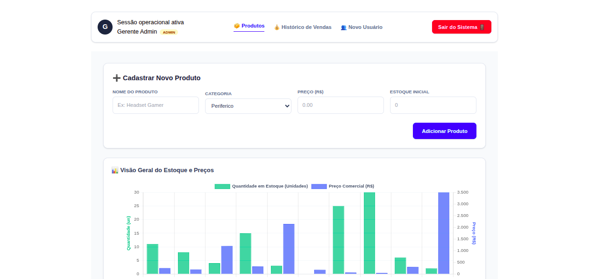
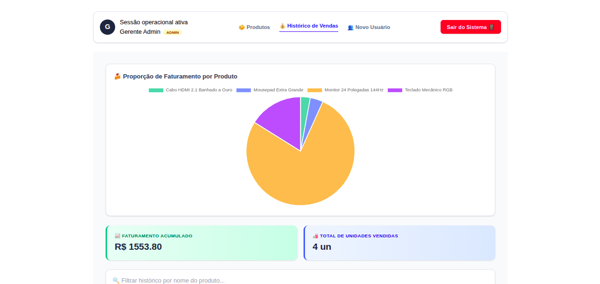
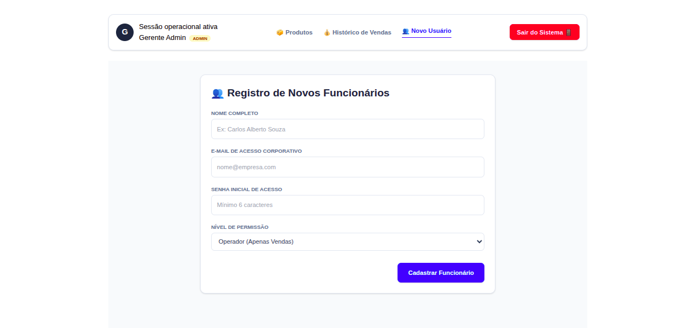

# 📦 Sistema de Controle de Estoque e Vendas (Full-Stack)

Aplicação web Full-Stack e responsiva para controle de inventário, registro de vendas com baixa automática de estoque e auditoria financeira. O sistema conta com autenticação criptografada, controle de permissões por cargo (Administrador e Operador) e gráficos interativos em tempo real.

🔗 **Acesse o sistema online:** [Clique aqui para abrir na Vercel](https://estoque-e-vendas-pg.vercel.app/login)

---

## 🛠️ Tecnologias e Serviços Utilizados

### 🌐 Front-end (Interface Web)

- **React + Vite**: Arquitetura baseada em componentes funcionais, hooks avançados (`useState`, `useEffect`, `useRef`, `useMemo`, `useContext`) e renderização SPA de alta performance.
- **React Router Dom v6**: Gerenciamento de rotas protegidas (`ProtectedRoute`) e navegação fluida sem recarregamento de página.
- **Tailwind CSS**: Estilização utilitária responsiva com abordagem _Mobile-First_.
- **Axios**: Instância centralizada com _Interceptors_ para envio automático de tokens JWT e tratamento global de sessão expirada.
- **Chart.js (`react-chartjs-2`)**: Gráficos dinâmicos de barras verticais (estoque vs. preço) e setores/pizza (proporção de faturamento).

### 🖥️ Back-end (API RESTful)

- **Node.js & Express**: Servidor modularizado seguindo o padrão arquitetural **MVC** (Model-View-Controller) com ES Modules (`import/export`).
- **Node-Postgres (`pg`)**: Pool de conexões assíncronas com queries parametrizadas e cláusulas `RETURNING`.
- **JSON Web Tokens (JWT) & BcryptJS**: Autenticação baseada em tokens temporários e encriptação de senhas com _salt_.
- **Dotenv**: Gerenciamento seguro de variáveis de ambiente.

### 🗄️ Banco de Dados e Infraestrutura em Nuvem

- **PostgreSQL**: Banco de dados relacional com modelagem normalizada (_Lookup Tables_), chaves estrangeiras (`FOREIGN KEY`), consultas com `INNER JOIN`, tipos `TIMESTAMPTZ` e transações atômicas (`BEGIN`, `COMMIT`, `ROLLBACK`).
- **Vercel**: Hospedagem contínua (CI/CD) do Front-end React.
- **Render**: Hospedagem do servidor Node.js.
- **Neon.tech**: Banco de dados PostgreSQL Serverless na nuvem.

---

## 📸 Demonstração do Sistema

### 1. Tela de Login e Autenticação



### 2. Painel de Controle e Estoque (Visão do Administrador)



### 3. Histórico de Vendas e Gráfico de Faturamento



### 4. Cadastro de Novos Usuários (Controle de Acesso)



---

## 📂 Arquitetura do Projeto (Monorepo)

```text
sistema-estoque/
├── backend/                  # API Node.js + Express (Arquitetura MVC)
│   ├── src/
│   │   ├── config/           # Conexão Pool com PostgreSQL (SSL)
│   │   ├── controllers/      # Regras de negócio e transações SQL
│   │   ├── middlewares/      # Validação de Token JWT
│   │   └── routes/           # Endpoints da API RESTful
│   └── server.js
│
└── frontend-react/           # Interface SPA React + Tailwind CSS
    ├── src/
    │   ├── components/       # Componentes reutilizáveis (Tabelas, Gráficos, Formulários)
    │   ├── context/          # Estado global de autenticação (AuthContext)
    │   ├── services/         # Configuração do Axios e Interceptors
    │   └── views/            # Páginas principais da aplicação
    └── vercel.json           # Configuração de rotas SPA na Vercel
```

---

## 🚀 Como Executar Localmente (Ubuntu/Linux)

### 1. Clonar o repositório

```bash
git clone https://github.com/aldosds/estoque-e-vendas-mysql-api-axios-react.git
cd estoque-e-vendas-mysql-api-axios-react
```

### 2. Configurar o Banco de Dados (PostgreSQL)

Crie um banco chamado `sistema_estoque_pg` e execute o script abaixo no `psql`:

```sql
CREATE TABLE niveis_acesso (
    id SERIAL PRIMARY KEY,
    nome VARCHAR(50) NOT NULL UNIQUE
);

INSERT INTO niveis_acesso (nome) VALUES ('admin'), ('operador');

CREATE TABLE usuarios (
    id SERIAL PRIMARY KEY,
    nome VARCHAR(100) NOT NULL,
    email VARCHAR(100) NOT NULL UNIQUE,
    senha TEXT NOT NULL,
    nivel_acesso_id INT NOT NULL REFERENCES niveis_acesso(id)
);

CREATE TABLE produtos (
    id SERIAL PRIMARY KEY,
    nome VARCHAR(150) NOT NULL UNIQUE,
    categoria VARCHAR(50) NOT NULL,
    preco NUMERIC(10, 2) NOT NULL,
    estoque INT NOT NULL
);

CREATE TABLE vendas (
    id SERIAL PRIMARY KEY,
    produto_id INT NOT NULL REFERENCES produtos(id) ON DELETE CASCADE,
    quantidade INT NOT NULL,
    preco_unitario NUMERIC(10, 2) NOT NULL,
    valor_total NUMERIC(10, 2) NOT NULL,
    data_venda TIMESTAMPTZ DEFAULT CURRENT_TIMESTAMP
);
```

### 3. Configurar e Rodar o Back-end

```bash
cd backend
npm install
```

Crie um arquivo `.env` na pasta `backend/` com as variáveis `PORT=3000`, `DB_HOST`, `DB_PORT`, `DB_USER`, `DB_PASS`, `DB_NAME` e `JWT_SECRET`, e inicie o servidor:

```bash
npm start
```

### 4. Configurar e Rodar o Front-end

```bash
cd ../frontend-react
npm install
npm run dev
```
